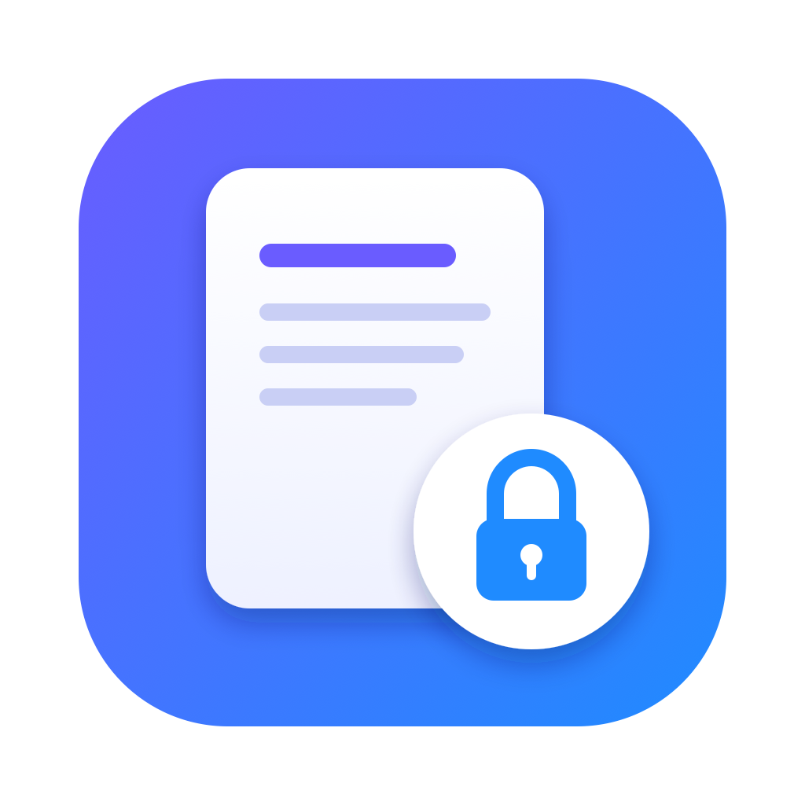
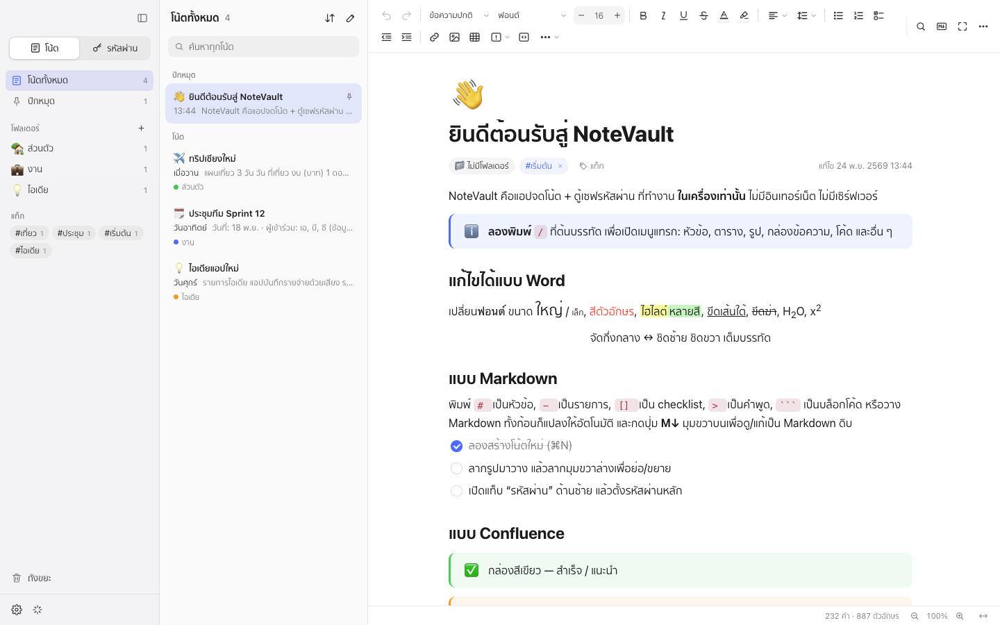
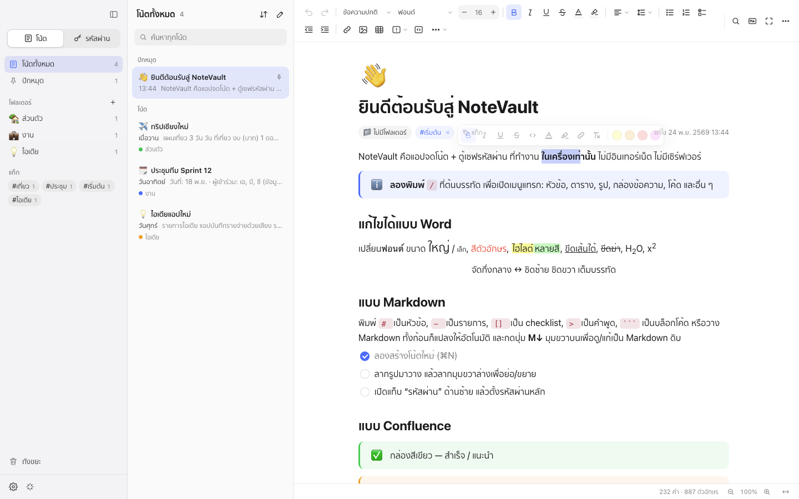
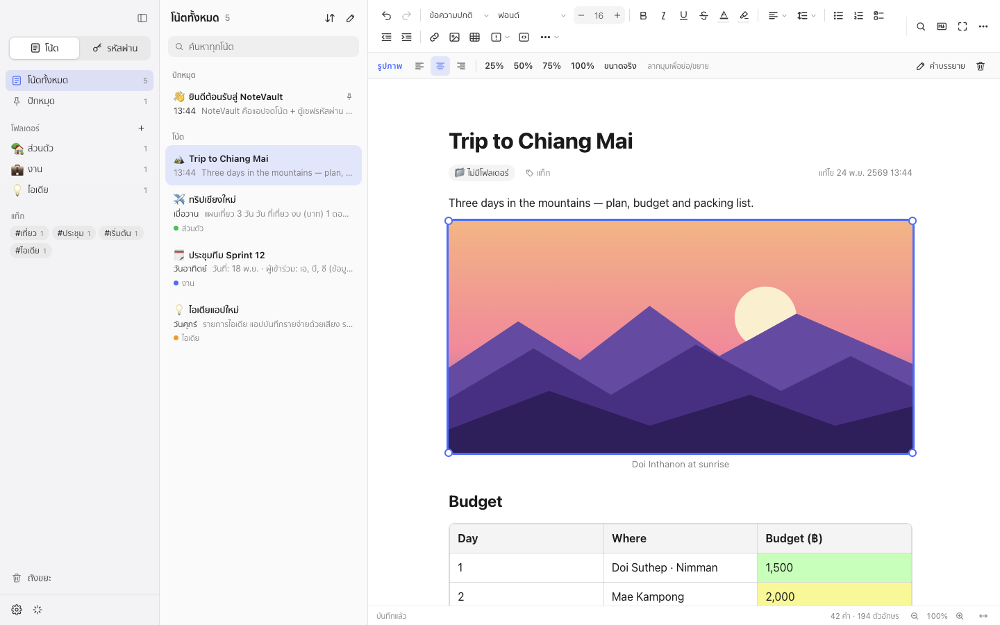
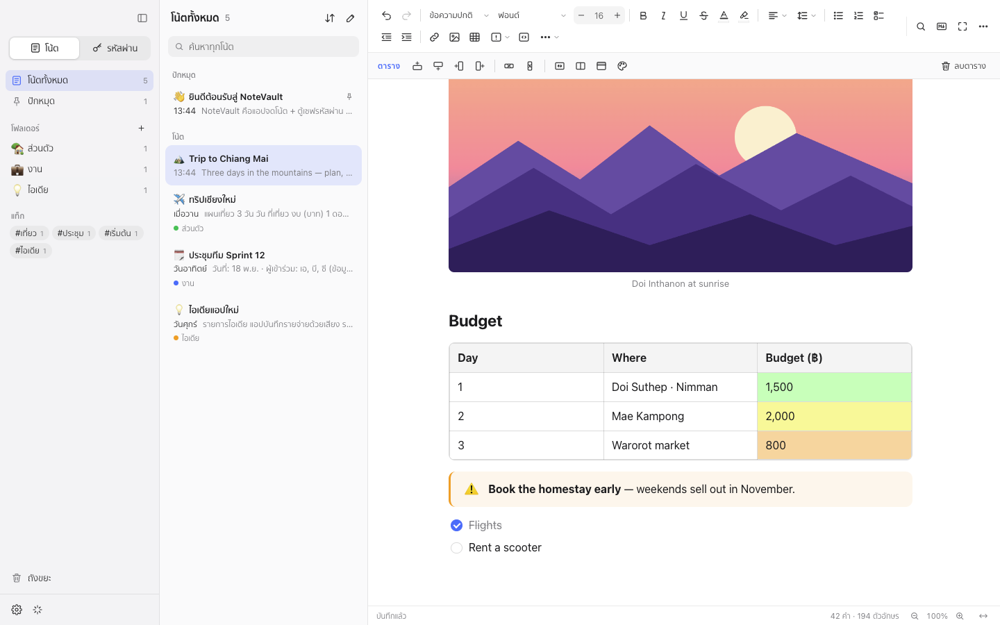
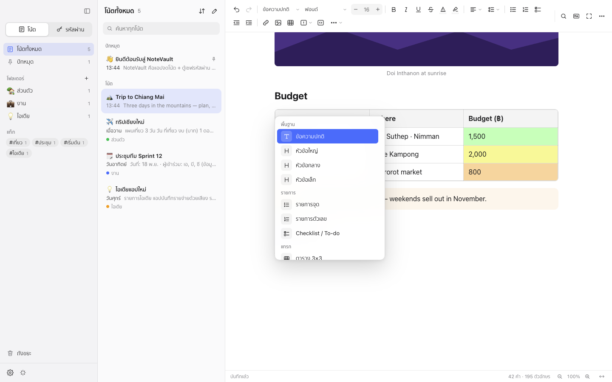
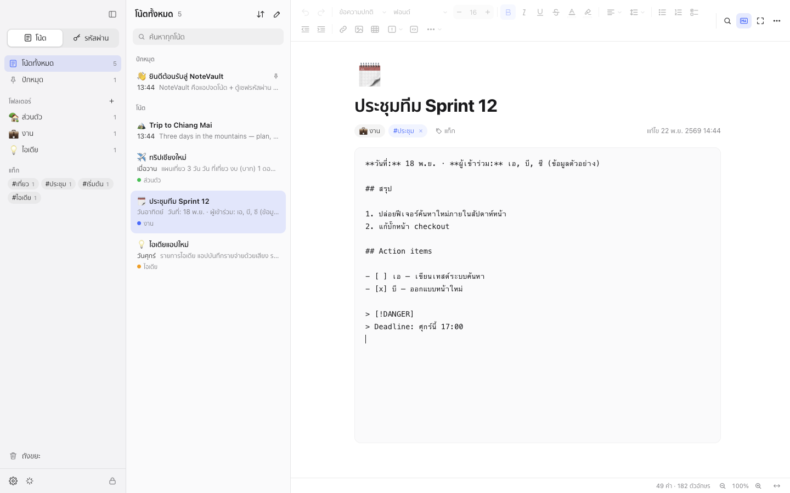
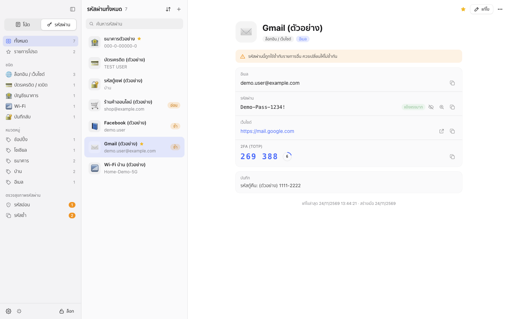
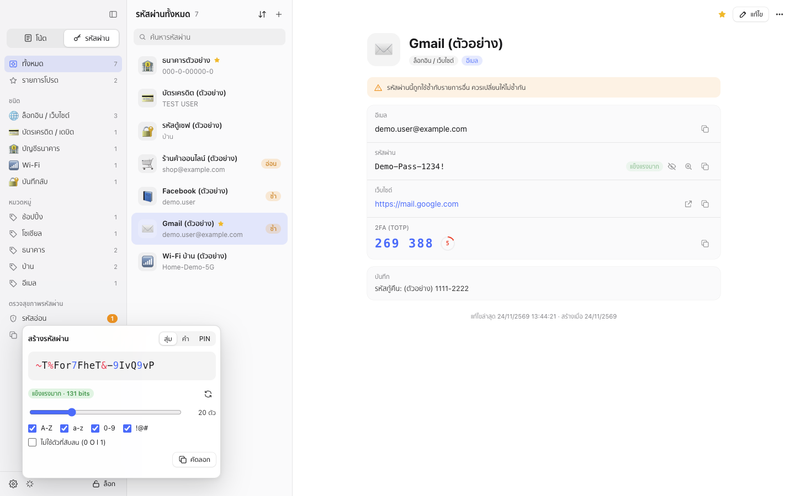
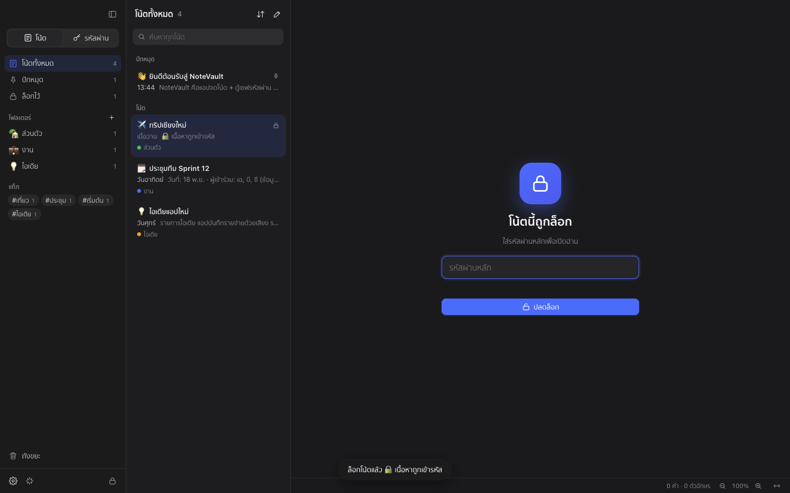

<div align="center">



# NoteVault

**Rich notes + an encrypted password vault for macOS. Local-first, offline, yours.**

Word-level formatting · Confluence-style blocks · real Markdown · AES-256 password vault — in one fast native-feeling app.


[Features](#-features) · [Install](#-install) · [Shortcuts](#%EF%B8%8F-keyboard-shortcuts) · [Security](#-security-model) · [ภาษาไทย](#-ภาษาไทย)

<picture>
  <source media="(prefers-color-scheme: dark)" srcset="docs/screenshots/hero-dark.png" />
  
</picture>

</div>

---

## Why NoteVault?

Apple Notes is lovely but hard to customise. Notion and Confluence are powerful but live in the cloud. NoteVault gives you the **editing power of Word + Confluence + Markdown** and a **built-in password manager**, while keeping every byte on your own disk.

- 🖥️ **A real Mac app.** Vibrancy sidebar, native menus, traffic lights, light and dark mode.
- 🔌 **No server, no account, no network.** It never phones home.
- 🧑‍💻 **No Apple Developer account and no Xcode.** Build it yourself with Node.
- 📁 **Plain files.** One JSON file per note, so a folder in iCloud Drive syncs it between Macs.

## ✨ Features

### ✍️ An editor that does everything

| | |
|---|---|
|  | **Format like Word**<br/>Fonts (including macOS Thai fonts), font size, text colour, **multi-colour highlight**, bold / italic / underline / strike, super- and subscript, headings 1–4, alignment, line spacing and indentation.<br/><br/>Select text to get a floating format bar with one-click highlight colours. |
|  | **Images you can actually lay out**<br/>Drag and drop, paste (⌘V) or pick a file. **Drag any corner to resize**, or use 25 / 50 / 75 / 100 %. Float an image left or right so text wraps around it, and add a caption. |
|  | **Real tables**<br/>Pick the size from a grid. Add or remove rows and columns, **merge and split cells**, drag column borders, toggle header rows and **colour cells**. A table toolbar appears when your cursor is inside one. |
|  | **Type `/` for anything**<br/>Headings, lists, checklists, tables, images, links, dividers, today's date, quotes, code blocks, and six Confluence-style **callout panels** (info, success, warning, danger, note, idea). |
|  | **Markdown, both ways**<br/>Markdown shortcuts while you type (`#`, `-`, `1.`, `[]`, `>`, ```` ``` ````, `**bold**`). Paste a Markdown document and it converts itself. Press **⌘⇧M** to edit the raw Markdown source. Export to `.md`, `.html` or `.pdf`. |

Also included:
- Code blocks with syntax highlighting for 24 languages
- Find & replace inside a note
- Zoom from 50 to 250 %
- Focus mode
- Adjustable page width
- Word count
- Spell check

### 🗂️ Organise

- **Folders** with an icon and a colour. Drag notes onto a folder to move them.
- **Tags**, **pins**, and an emoji icon per note.
- **Search across all notes**, with matches highlighted in the list.
- **Trash** with restore. Empty notes you leave behind are discarded, like Apple Notes.
- **Autosave.** There is no save button.

### 🔐 A password vault built in

| | |
|---|---|
|  | **Everything in one place**<br/>Item types: logins, cards, bank accounts, Wi-Fi, ID documents, secure notes and custom items, each with as many fields as you need.<br/><br/>**Built-in 2FA (TOTP)** codes with a countdown. Click any field to copy it. Copied secrets are wiped from the clipboard after 30 s. |
|  | **Generator and health check**<br/>Random passwords, word passphrases or PINs, with a strength meter. The sidebar lists **weak** and **reused** passwords so you know what to fix. |
|  | **Lock individual notes**<br/>Any note can be encrypted with the same master password. A locked note's body is ciphertext on disk, and its text disappears from the list and from search. |

- **Unlock with Touch ID.**
- **Auto-lock** after inactivity, on screen lock and on sleep.
- A **large-type view** for reading long passwords.
- **Import** from JSON and **export** an encrypted copy.

## 📦 Install

Requires **Node.js 20+** (`brew install node`).

```bash
git clone https://github.com/pucksaeroi-beep/notevault.git
cd notevault
npm install
npm run install-app        # builds NoteVault.app and copies it to /Applications
```

Open it from Spotlight or Launchpad. You build it on your own machine, so Gatekeeper doesn't block it and you don't need code signing.

| Command | What it does |
|---|---|
| `npm run dev` | Development mode with hot reload |
| `npm start` | Build, then run from the repo |
| `npm run dist` | Build `release/mac-arm64/NoteVault.app` |
| `npm run install-app` | `dist` + copy to `/Applications` |
| `npm test` | Crypto and storage tests |

## ⌨️ Keyboard shortcuts

| Action | Keys | | Action | Keys |
|---|---|---|---|---|
| New note | <kbd>⌘</kbd><kbd>N</kbd> | | Insert menu | <kbd>/</kbd> |
| New folder | <kbd>⌘</kbd><kbd>⇧</kbd><kbd>N</kbd> | | Link | <kbd>⌘</kbd><kbd>K</kbd> |
| New password item | <kbd>⌘</kbd><kbd>⌥</kbd><kbd>N</kbd> | | Highlight | <kbd>⌘</kbd><kbd>⇧</kbd><kbd>H</kbd> |
| Notes / Passwords | <kbd>⌘</kbd><kbd>1</kbd> / <kbd>⌘</kbd><kbd>2</kbd> | | Heading 1–4 | <kbd>⌘</kbd><kbd>⌥</kbd><kbd>1</kbd>…<kbd>4</kbd> |
| Search all notes | <kbd>⌘</kbd><kbd>⇧</kbd><kbd>F</kbd> | | Numbered / bullet / checklist | <kbd>⌘</kbd><kbd>⇧</kbd><kbd>7</kbd> <kbd>8</kbd> <kbd>9</kbd> |
| Find / replace in note | <kbd>⌘</kbd><kbd>F</kbd> / <kbd>⌘</kbd><kbd>⌥</kbd><kbd>F</kbd> | | Align centre / left / right | <kbd>⌘</kbd><kbd>⇧</kbd><kbd>E</kbd> <kbd>L</kbd> <kbd>R</kbd> |
| Raw Markdown | <kbd>⌘</kbd><kbd>⇧</kbd><kbd>M</kbd> | | Indent / outdent | <kbd>Tab</kbd> / <kbd>⇧</kbd><kbd>Tab</kbd> |
| Zoom in / out / reset | <kbd>⌘</kbd><kbd>=</kbd> <kbd>⌘</kbd><kbd>-</kbd> <kbd>⌘</kbd><kbd>0</kbd> | | Export PDF | <kbd>⌘</kbd><kbd>P</kbd> |
| Focus mode | <kbd>⌘</kbd><kbd>⇧</kbd><kbd>\\</kbd> | | Lock vault | <kbd>⌘</kbd><kbd>L</kbd> |
| Toggle sidebar | <kbd>⌘</kbd><kbd>\\</kbd> | | Password generator | <kbd>⌘</kbd><kbd>G</kbd> |

## 📝 Markdown example

Paste this into any note. It becomes headings, a checklist, a callout, a highlight and a table:

```markdown
## Release checklist

- [x] Write changelog
- [ ] Tag the release

> [!WARNING]
> Don't forget to bump the version number.

Ship it ==this Friday==.

| Platform | Status |
|----------|--------|
| macOS    | ✅     |
```

GitHub-style alerts (`> [!NOTE]`, `[!TIP]`, `[!WARNING]`, `[!CAUTION]` …) become callout panels, and `==text==` becomes a highlight. Export goes back the same way.

## 🔑 Importing passwords

Settings → Vault → **Import JSON** accepts:

```json
{
  "items": [
    {
      "type": "login",
      "title": "Example account",
      "category": "Email",
      "fields": [
        { "label": "Username", "value": "me@example.com" },
        { "label": "Password", "value": "correct-horse-battery", "secret": true },
        { "label": "2FA", "value": "JBSWY3DPEHPK3PXP", "kind": "totp" }
      ],
      "notes": "Recovery codes are in the safe."
    }
  ]
}
```

- `type` is one of `login`, `card`, `bank`, `wifi`, `identity`, `note` or `other`.
- `kind` is one of `text`, `password`, `pin`, `email`, `url`, `phone`, `totp` or `multiline`.

> Delete the plaintext JSON file once it is imported.

## 🛡 Security model

| | |
|---|---|
| Key derivation | `scrypt` (N = 2¹⁷, r = 8, p = 1) from your master password |
| Encryption | AES-256-GCM. A random data key is wrapped by the password key, so changing the password only re-wraps it |
| At rest | `vault.json` holds only ciphertext. Locked notes are encrypted with the same data key |
| In memory | The key lives only in the main process. It is wiped on lock, screen lock, sleep and quit |
| Touch ID | Stores the data key with macOS `safeStorage` (Keychain) behind `promptTouchID` |
| Backups | The last 30 encrypted versions are kept automatically in `backups/` |
| Renderer | Sandboxed, context-isolated, strict CSP, no Node access, all data rendered through `textContent` |

> ⚠️ **If you forget the master password, no one can recover the vault.** There is no backdoor.

## 💾 Where data lives

Your data is stored in `~/Library/Application Support/NoteVault/Library/`. You can change this under Settings → Data, for example to an iCloud Drive folder to share it between Macs.

```
notes/<id>.json   one note per file (locked notes are encrypted)
folders.json
assets/           images
vault.json        password vault (encrypted)
backups/          automatic encrypted vault backups
```

This repository contains **only code and fake demo data** (`electron/mock.cjs`). Your notes and passwords never live in the repo.

## 🧱 Project structure

```
electron/
  main.cjs        window, menus, IPC, nv:// protocol
  vault.cjs       vault crypto
  library.cjs     notes / folders / images on disk
  mock.cjs        demo content (fake)
src/
  main.js         app shell: sidebar, note list, settings
  editor/         TipTap editor, toolbar, slash menu, Markdown ⇄ HTML
  vault/          vault UI, generator, TOTP, strength meter
test/             node:test suite for crypto and storage
```

Built with [Electron](https://www.electronjs.org/), [TipTap](https://tiptap.dev/) / ProseMirror, [lowlight](https://github.com/wooorm/lowlight), [marked](https://marked.js.org/), [turndown](https://github.com/mixmark-io/turndown) and [Vite](https://vitejs.dev/).

---

## 🇹🇭 ภาษาไทย

**NoteVault** คือแอปจดโน้ตพร้อมตู้เซฟรหัสผ่านสำหรับ Mac ทำงานในเครื่องเท่านั้น ไม่ต้องต่ออินเทอร์เน็ต ไม่ต้องมีบัญชี Apple Developer และไม่ต้องลง Xcode

**ติดตั้ง**

```bash
git clone https://github.com/pucksaeroi-beep/notevault.git && cd notevault
npm install && npm run install-app
```

**ทำอะไรได้บ้าง**

- **แก้ไขแบบ Word:** ฟอนต์, ขนาด, สี, ไฮไลต์, จัดหน้า, ระยะบรรทัด
- **ตาราง:** รวม/แยกเซลล์ และใส่สีพื้นเซลล์
- **รูปภาพ:** ลากมุมเพื่อย่อ/ขยาย และวางลอยให้ข้อความล้อมรอบ
- **กล่องข้อความแบบ Confluence**
- **เมนูแทรก:** พิมพ์ `/` เพื่อแทรกหัวข้อ ตาราง รูป และอื่นๆ
- **Markdown:** ใช้ได้ทั้งตอนพิมพ์ ตอนวาง และแก้ไฟล์ดิบ (⌘⇧M)
- **จัดระเบียบ:** โฟลเดอร์, แท็ก, ปักหมุด, ค้นหาทุกโน้ต, ถังขยะ
- **ตู้เซฟรหัสผ่าน:**
  - เข้ารหัสแบบ AES-256 และปลดล็อกด้วย Touch ID ได้
  - แสดงรหัส 2FA และมีตัวสร้างรหัสผ่าน
  - แจ้งรหัสที่อ่อนหรือใช้ซ้ำ
  - ล้างคลิปบอร์ดเองหลังคัดลอก
- **ล็อกโน้ต:** โน้ตแต่ละอันเข้ารหัสได้ด้วยรหัสผ่านหลักเดียวกัน

**ใช้หลายเครื่อง:** ตั้งโฟลเดอร์ข้อมูลไว้ใน iCloud Drive ที่ ตั้งค่า → ข้อมูล ทุกเครื่อง แต่อย่าเปิดแอปพร้อมกันสองเครื่อง

> ⚠️ ถ้าลืมรหัสผ่านหลัก จะเปิดตู้เซฟไม่ได้อีกเลย
